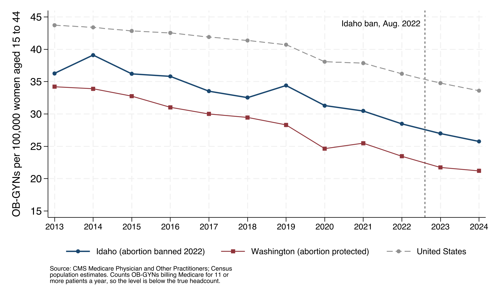

# Idaho maternity care before and after the 2022 abortion ban: public data and replication code

Gabrielle Sorresso, Cornell University. October 2026.

This repository holds the data and Stata code behind a short piece on maternity care in Idaho after the state banned abortion in August 2022. Every number here comes from public federal data, and one do-file reproduces all of them.

**[Download everything (ZIP)](https://github.com/gns36/idaho-maternity-care-data/archive/refs/heads/main.zip)** · then open Stata in the folder and run `do replicate.do`.

## What the data show

### OB-GYNs per woman were falling in Idaho before the ban, at a pace similar to Washington's

OB-GYNs billing Medicare per 100,000 women aged 15 to 44:

| | 2016 | 2021 | 2024 | Change per year, 2016 to 2021 | Change per year, 2021 to 2024 |
|---|---|---|---|---|---|
| Idaho (abortion banned August 2022) | 35.8 | 30.5 | 25.8 | −3.2% | −5.4% |
| Washington (abortion protected) | 31.0 | 25.5 | 21.2 | −3.9% | −5.9% |
| United States | 42.5 | 37.9 | 33.6 | −2.3% | −3.9% |

Idaho had 116 such OB-GYNs in 2016, 113 in 2021 and 101 in 2024, while its population of women aged 15 to 44 grew 14 percent from 2016 to 2021. Idaho ranked 45th of 51 (the 50 states and DC) in 2021. The decline was faster after 2021 than before in Idaho, in Washington, where abortion is protected, and in the country as a whole.

### Births moved from West Valley Medical Center to a newer unit eight miles away

West Valley Medical Center in Caldwell closed its labor and delivery unit on April 1, 2024. St. Luke's Nampa, about eight road miles away, began delivering babies in December 2017.

| Newborn nursery days | FY2016 | FY2018 | FY2023 |
|---|---|---|---|
| West Valley Medical Center, Caldwell | 1,058 | 724 | 448 (−58% from FY2016) |
| St. Luke's Nampa | (not yet open) | 971 (opened December 2017) | 1,847 |

Hospitals do not publish birth counts; newborn nursery days from their Medicare cost reports track births within a hospital over time.

## How to reproduce

1. Download this repository ([ZIP](https://github.com/gns36/idaho-maternity-care-data/archive/refs/heads/main.zip)) or clone it.
2. Open Stata 16 or later, change the working directory to the repository folder, and run `do replicate.do`.
3. The do-file writes tables to `Output/` and the figure to `figures/`. It stops with an error if any number above no longer matches the data.

`replicate.do` is commented throughout: each step says what it does and why.

## Data

All files in `Data/` are extracts of public U.S. government data, retrieved October 20, 2026.

| File | What it is | Original source |
|---|---|---|
| [`Data/cms_mupphy_obgyn_rows.csv`](Data/cms_mupphy_obgyn_rows.csv) | One row per OB-GYN (national provider identifier) per year, 2013 to 2024 | CMS, [Medicare Physician and Other Practitioners, by Provider](https://data.cms.gov/provider-summary-by-type-of-service/medicare-physician-other-practitioners/medicare-physician-other-practitioners-by-provider) |
| [`Data/census_women15_44_by_state_year.csv`](Data/census_women15_44_by_state_year.csv) | Women aged 15 to 44 by state, July 1 estimates, 2013 to 2025 | Census Bureau Population Estimates, state files by age and sex: [Vintage 2020](https://www2.census.gov/programs-surveys/popest/datasets/2010-2020/state/asrh/SC-EST2020-ALLDATA6.csv) (2013 to 2019) and [Vintage 2025](https://www2.census.gov/programs-surveys/popest/datasets/2020-2025/state/asrh/sc-est2025-alldata6.csv) (2020 to 2025) |
| [`Data/hcris_idaho_newborn_days.csv`](Data/hcris_idaho_newborn_days.csv) | Newborn nursery and labor and delivery days from cost reports of Idaho hospitals with obstetric units, fiscal years 2016 to 2024 | CMS, [Hospital Cost Reports (HCRIS), form 2552-10](https://www.cms.gov/data-research/statistics-trends-and-reports/cost-reports/hospital-2552-2010-form) |

To rebuild `Data/` from the original sources (Python 3 with pandas and requests):

- `python3 Build/01_download_cms_mupphy.py` downloads the OB-GYN rows of the CMS file for every year through the data.cms.gov API.
- `python3 Build/02_build_census.py` downloads the Census files and computes women aged 15 to 44 by state and year.
- `python3 Build/03_extract_hcris.py <folder> .` reads the annual HCRIS files (`HOSP10FY2016.ZIP` to `HOSP10FY2024.ZIP`, for example https://downloads.cms.gov/FILES/HCRIS/HOSP10FY2016.ZIP) saved in `<folder>`.

## What these measures can and cannot show

- **The OB-GYN count is not a headcount.** It includes OB-GYNs who billed Medicare Part B for at least 11 patients in a year, so it misses those who see very few Medicare patients, often those focused on obstetrics. The national count falls every year (8 percent from 2021 to 2024), partly because Medicare billing patterns change. Use it to compare states and periods.
- **The two periods are different lengths,** so changes are shown per year.
- **Newborn nursery days approximate births.** A newborn usually stays one to two days, so levels are rough; the trend within each hospital is the informative part.
- **These are descriptive comparisons,** not estimates of the effect of the ban.

## Other sources referenced in the piece

- Lisa Lerer, “[When Idaho Banned Abortion, OB-GYNs Fled. The Doctors Who Stayed Are Cracking](https://www.nytimes.com/2026/10/20/magazine/idaho-abortion-ban-ob-gyns.html),” New York Times Magazine, October 20, 2026.
- Staiger et al., “[Obstetrician and Gynecologist Physicians’ Practice Locations Before and After the Dobbs Decision](https://jamanetwork.com/journals/jamanetworkopen/fullarticle/2833030),” JAMA Network Open, 2025.
- Strasser et al., “[Lower OBGYN Supply in Abortion-Ban States, Despite Minimal State-Level Changes in the 2 Years Post-Dobbs](https://academic.oup.com/healthaffairsscholar/article/2/12/qxae162/7909263),” Health Affairs Scholar, 2024.
- Kozhimannil et al., “[Obstetric Care Access Declined in Rural and Urban Hospitals across US States, 2010–22](https://doi.org/10.1377/hlthaff.2024.01552),” Health Affairs, 2025.
- Washington Reproductive Privacy Act, [RCW 9.02](https://app.leg.wa.gov/rcw/default.aspx?cite=9.02).
- KMVT, “[St. Luke’s Jerome Medical Center temporarily pausing obstetric, operating room services](https://www.kmvt.com/2021/07/30/st-lukes-jerome-medical-center-temporarily-pausing-obstetric-operating-room-services/),” July 30, 2021.

## Contact

Gabrielle Sorresso, PhD candidate, Brooks School of Public Policy, Cornell University · [gabriellesorresso.com](https://gabriellesorresso.com)

Code is released under the MIT License. The data are public U.S. government data.
